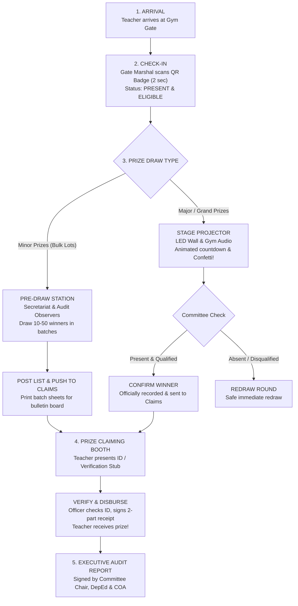

# 🍎 Municipal Teachers' Day 2026 Digital Raffle System
# 📘 Complete Operations Manual & Staff Briefing Handbook
**Municipality of Malungon, Province of Sarangani**  
*An Easy-to-Understand, Plain-Language Guide for the Teachers' Committee, Gate Attendance Staff, Stage Operators, Pre-Draw Secretariat, and Prize Claiming Officers*

---

## 🌟 Welcome to the 2026 Teachers' Day Raffle System

Welcome to the official briefing manual for the **Municipal Teachers' Day 2026 Digital Raffle System**! 

Every year, over **2,000 hardworking teachers and school staff** from across Malungon gather at the gymnasium to celebrate. In past years, drawing raffle prizes using paper stubs in a *tambiolo* (spinning wire drum) took **3 to 5 exhausting hours**, paper stubs got crumpled or lost, and teachers worried whether the draw was truly fair.

This modern digital raffle system was built specifically to solve those problems:
* ⚡ **Fast & Smooth:** Gate registration takes less than 2 seconds per teacher.
* 🛡️ **100% Honest & Fair:** Certified mathematical randomizer. No secret tricks, no favoritism ("*no palakasan*"), and no accidental double-wins.
* 📺 **Exciting & Grand:** All 5 educational districts are displayed side-by-side on the gymnasium LED wall with ticking countdown reels, celebratory fanfare, and exploding confetti!
* 📋 **Audit-Ready & Transparent:** Every ticket scan, draw spin, and prize claim is logged with exact timestamps for DepEd and Commission on Audit (COA) compliance.
* 🔌 **Zero Panic (Works 100% Offline):** Even if the gymnasium Wi-Fi drops completely, the entire system keeps running without stopping.

---

## 📑 Table of Contents

1. [The 3 Golden Guarantees of the System](#1-the-3-golden-guarantees-of-the-system)
2. [Eligibility Rules: Who Can Win What?](#2-eligibility-rules-who-can-win-what)
3. [The 5 Educational Groupings (Fair District Representation)](#3-the-5-educational-groupings-fair-district-representation)
4. [How the Event Flows (From Arrival to Celebration)](#4-how-the-event-flows-from-arrival-to-celebration)
5. [The System Workstations & Web Addresses (URLs)](#5-the-system-workstations--web-addresses-urls)
6. [Module 1: Gate Attendance & Check-In Station (`/attendance`)](#6-module-1-gate-attendance--check-in-station-attendance)
7. [Module 2: Live Stage & Big Screen Projector (`/`)](#7-module-2-live-stage--big-screen-projector-)
8. [Module 3: Pre-Draw Station for Minor Prizes (`/admin` & `/pre-draw`)](#8-module-3-pre-draw-station-for-minor-prizes-admin--pre-draw)
9. [Module 4: Print Queue Station (Batch Sheets & Stubs)](#9-module-4-print-queue-station-batch-sheets--stubs)
10. [Module 5: Real-Time Prize Claiming Station (`/claims`)](#10-module-5-real-time-prize-claiming-station-claims)
11. [Module 6: Master Admin Console, Settings & Reports (`/admin`)](#11-module-6-master-admin-console-settings--reports-admin)
12. [Role-by-Role Quick Action Cheat Sheets](#12-role-by-role-quick-action-cheat-sheets)
13. [Emergency Troubleshooting & "What If...?" Guide](#13-emergency-troubleshooting--what-if-guide)

---

## 1. The 3 Golden Guarantees of the System

### 1. Absolute Fairness (Certified Mathematical Randomness)
Every teacher who checks in at the gate gets **exactly one equal chance** in the candidate pool. The system uses the industry-standard **Fisher-Yates shuffling algorithm** (the same mathematics used in state lotteries). Neither the IT operator, the emcee, nor any committee official can rig or predict who will win.

### 2. Equal Stage Visibility (The 5-District Display)
No school is forgotten. On the giant gym LED wall, names spin across **5 district columns side-by-side**. Teachers from remote mountain schools in Malungon have the exact same visibility and odds as teachers from central schools.

### 3. The "Check First" Rule (Zero-Mistake Confirmation)
When names appear on the screen, they are **provisional (temporary)**:
* If the teacher is present and qualified, the committee clicks **"Confirm Winners"** $\rightarrow$ it becomes official and immediately appears at the Claims Desk!
* If the winner is absent (if the committee rule requires physical presence) or disqualified, the operator clicks **"Redraw Round"** $\rightarrow$ the system picks a fresh name with **zero damage to records, no lost prizes, and no confusion**.

---

## 2. Eligibility Rules: Who Can Win What?

To ensure total transparency, the Teachers' Committee has established clear eligibility guidelines:

| Personnel Group | Minor Prizes (Appliances, Cash, Gifts) | Grand Prize (Top Jackpots / Major Items) | Notes & Guidelines |
|---|:---:|:---:|---|
| **Classroom Teachers** (Teacher I, II, III, Master Teachers, Head Teachers) | ✅ **ELIGIBLE** | ✅ **ELIGIBLE** | Qualified upon gate check-in / active registration. |
| **School Principals & PSDS** | ✅ **ELIGIBLE** | ✅ **ELIGIBLE** | Public Schools District Supervisors are mapped to their respective district groupings. |
| **Daycare (ECCD) Teachers** | ✅ **ELIGIBLE** | ✅ **ELIGIBLE** | Grouped under "Private / ECCD / LSB". |
| **Local School Board (LSB) Teachers** | ✅ **ELIGIBLE** | ✅ **ELIGIBLE** | Grouped under "Private / ECCD / LSB". |
| **Private School Educators** | ✅ **ELIGIBLE** | ✅ **ELIGIBLE** | Grouped under "Private / ECCD / LSB". |
| **Non-Teaching Staff** (Admin, Clerks, Utility, Security, Nurses) | 🟢 **MINOR PRIZES ONLY** | ❌ **EXCLUDED** | Non-teaching staff are included in all Minor Prize draws (both Live and Pre-Draw), but **strictly protected from winning the Grand Prize**. |

### Can someone win twice?
* **Default Rule: NO.** Once a teacher wins any prize, their name is locked as a winner and automatically excluded from all remaining draws.
* *(Note: In the unlikely event the committee decides to permit multiple wins, there is an official toggle in Admin Settings).*

### What happens if a prize is forfeited?
* If a winner is disqualified or absent, clicking **"Mark as Forfeited"** at the Claims Desk or Stage **immediately returns +1 unit back into the available prize inventory**. The prize can be redrawn right away for another lucky participant!

---

## 3. The 5 Educational Groupings (Fair District Representation)

To keep the celebration balanced and easy to follow, participants are organized into 5 visual groups:

```
┌────────────────────────────────────────────────────────────────────────┐
│                   MUNICIPALITY OF MALUNGON (5 GROUPS)                   │
├──────────────┬──────────────┬──────────────┬──────────────┬────────────┤
│ 01. NORTH    │ 02. EAST     │ 03. WEST     │ 04. SOUTH    │ 05. PRIVATE│
│ North Elem   │ East Elem    │ West Elem    │ South Elem   │ ECCD / Day │
│ & High       │ & High       │ & High       │ & High       │ Private Sch│
│ Schools      │ Schools      │ Schools      │ Schools      │ LSB Staff  │
└──────────────┴──────────────┴──────────────┴──────────────┴────────────┘
```

* **North District:** All public elementary and secondary schools in the North zone + North PSDS.
* **East District:** All public elementary and secondary schools in the East zone + East PSDS.
* **West District:** All public elementary and secondary schools in the West zone + West PSDS.
* **South District:** All public elementary and secondary schools in the South zone + South PSDS.
* **Private / ECCD / LSB:** All private school teachers, municipal ECCD daycare workers, and Local School Board educators.

---

## 4. How the Event Flows (From Arrival to Celebration)



---

## 5. The System Workstations & Web Addresses (URLs)

The system works both on **local laptops** and on the **official cloud website**:
* **Cloud URL:** `https://teachers-day-raffle-system.web.app` (or local venue network: `http://localhost:3000`)
* **Default Security PIN:** `2026`

| Workstation | Direct Web Address | Default PIN | Who Uses It? | Primary Equipment |
|---|---|:---:|---|---|
| **1. Gate Attendance** | `/attendance` | `2026` | Gate Marshals / Check-In Staff | Laptop or Tablet + Barcode Gun / Camera |
| **2. Stage Projector** | `/` (Display Mode) | None | Projector Operator & Emcee | Laptop with HDMI to LED Wall + Gym Sound |
| **3. Pre-Draw Station** | `/admin` (Pre-Draw) | `2026` | Secretariat & Audit Witnesses | Laptop in Committee Room |
| **4. Pre-Draw Viewer** | `/pre-draw` | None | Side LED Screens / Kiosks | External Monitor or Projector |
| **5. Claims Station** | `/claims` | `2026` | Disbursing Officers & Marshals | 1-2 Laptops + Desktop Printer |
| **6. Master Admin** | `/` (Admin Tab) | `2026` | Committee Chair & IT Lead | Main Control Laptop |

---

## 6. Module 1: Gate Attendance & Check-In Station (`/attendance`)

### Purpose
To quickly check in arriving educators, verify their details, mark them as **PRESENT**, and immediately activate their names in the eligible raffle pool.

### How to Log In
1. On the gate laptop or tablet, open the browser to: `https://teachers-day-raffle-system.web.app/attendance`
2. Select your Gate Station (e.g., `Gate 1 - Gym Main Lobby`, `Gate 2 - North Entrance`).
3. Type the Gate Officer's Name (e.g., *Teacher Maria / Gate Committee*).
4. Enter the PIN: `2026`.
5. Click **Authenticate & Open Gate**.

---

### The 3 Check-In Modes

#### Mode A: USB / Bluetooth Barcode Gun (Recommended - Fastest)
* Connect the barcode scanner gun to the laptop.
* Click on the **Barcode Gun** tab (ensure the cursor is in the scan box).
* Scan the teacher's badge or printed QR ticket.
* **Scan time:** Less than 0.2 seconds!

#### Mode B: Built-in Camera / Webcam Scanning
* Click on the **Camera** tab.
* Click **Start Camera** (allow camera access when prompted by the browser).
* Hold the teacher's badge in front of the lens.
* The system automatically detects and scans the QR code.

#### Mode C: Manual Search (For Teachers Who Forgot Badges)
* If a teacher forgot, lost, or damaged their badge, do not panic!
* Click on the **Manual** tab.
* Type their **Surname**, **DepEd ID**, or **School**.
* Click **"Check In (Mark Present)"** next to their name.

---

### Audio & Visual Feedback: How to Know It Worked

* 🟢 **Success (First Check-In):**
  * A pleasant **double-chime sound** plays.
  * A large green box appears displaying: Teacher's Full Name, DepEd ID, District, School, and Position.
  * Their status instantly updates to **"PRESENT"** in the raffle pool.
* 🟠 **Duplicate Warning (Already Scanned):**
  * A distinct **warning buzz** sounds.
  * An amber warning alert appears: *"Already Checked-in at Gate 1 at 7:18 AM!"*
  * This prevents double-entries and fraudulent passes.
* 🔴 **Invalid QR / Not Found:**
  * An error tone sounds and the screen warns: *"Participant Not Found in Roster"*.

---

### What to Do If an Unlisted Teacher Arrives (Walk-Ins)
To maintain security, queue order, and proper administrative oversight during the event, **only the Master Admin Console (Committee Secretariat)** has permission to register new or walk-in teachers:
1. **At the Gate Entrances:** If a newly hired or substitute teacher's name is not found in the manual search, gate marshals politely direct the teacher to the **Master Admin / Secretariat Desk**.
2. **At the Master Admin Console (`/admin` $\rightarrow$ Participants tab):**
   * The Secretariat Officer clicks **➕ Add Walk-in Teacher**.
   * Fills in: Teacher Full Name, DepEd ID / PRN (optional), District, School, and Position.
   * Chooses Initial Status: **"Eligible (Checked In)"** to activate them immediately.
   * Clicks **Save Participant**.
3. They are instantly registered into the masterlist, saved to the database, and activated in the raffle pool!

---

### Printing Attendee Badges in Advance
Under the **Printable Badges** tab:
* Select district or school.
* Badges are automatically laid out **8 badges per sheet** on standard Letter paper.
* Each badge features: DepEd & Malungon logos, Teacher Name, School, District, and a sharp, high-contrast QR code for instant scanning.

---

## 7. Module 2: Live Stage & Big Screen Projector (`/`)

### Purpose
To project the thrilling live raffle draws onto the gymnasium's giant LED wall or main projector with dramatic animations, sound effects, countdowns, and confetti!

### Setting Up the Stage Laptop
1. Connect the stage laptop to the **LED Wall / Projector via HDMI cable**.
2. Connect the laptop's audio jack (3.5mm Aux or Bluetooth) to the **Gymnasium Audio Console / PA System**.
3. Open `https://teachers-day-raffle-system.web.app`.
4. Ensure the view is set to **Projector Display**.
5. Press **`F11`** on the keyboard (or click **Fullscreen**).
6. Click **"Toggle Full Stage"** $\rightarrow$ This hides all menu bars, displaying only the grand 2-2-1 district cards and current prize banner!

---

### How to Run a Live Draw (Step-by-Step)

```
[ Step 1: Select Prize ] ──► [ Step 2: Choose Mode & Quantity ] ──► [ Step 3: Commence Draw ]
                                                                             │
                                                                             ▼
[ Step 5: Confirm / Redraw ] ◄── [ Step 4: Watch Reel, Countdown & Confetti ]
```

1. **Select the Prize:** From the dropdown menu, select the prize being drawn (e.g. *₱10,000 Cash Prize* or *50-inch Smart TV*).
2. **Choose the Distribution Mode:**
   * **Combined Pool (Most Popular):** Draws winners completely at random from all checked-in teachers across all 5 districts.
   * **Equal Per District:** Draws an equal number of winners from each of the 5 districts simultaneously (e.g., 1 winner from North, 1 from East, 1 from West, 1 from South, 1 from Private).
   * **Target District:** Draws winners exclusively from one specific district (used when a sponsor designates a prize for a specific area).
3. **Set Number of Winners:** Choose how many winners to draw in this round (e.g., 1 for Grand Prize, 5 for Major Prizes).
4. **Click "Commence Draw →":** A review summary modal appears. Click **"Start Live Draw"**.

---

### What the Audience Sees on the Giant Screen

1. **Mechanical Shuffling:** Names inside all 5 district cards begin cycling rapidly with authentic mechanical ticking audio.
2. **Suspense Countdown:** The screen darkens slightly and displays an energetic **3... 2... 1...** countdown.
3. **The Reveal:** The winning name snaps into bold, luminous uppercase with their school name and district badge!
4. **Celebration:** Stadium victory fanfare blasts through the speakers and colorful confetti bursts across the entire LED wall!
5. **Grand Prize Spotlight:** When the ultimate Grand Prize is drawn, the screen transforms into a **Single Hero Spotlight Card** filling the entire display!

---

### The Two-Stage Confirmation Rule (Zero-Mistake Safety)

When the animation stops, the name on screen is **provisional (temporary)**. The operator sees two big buttons:

* **Button 1: 🟢 CONFIRM WINNERS**
  * Use this when the winner is acknowledged and verified.
  * Clicking this officially writes the winner into the database, subtracts 1 from remaining prize stock, marks the teacher as a winner, and instantly transmits their name to the **Claims Desk**!
* **Button 2: 🔄 REDRAW ROUND**
  * Use this if your event rules state *"Must be physically present to win"* and the drawn teacher is absent, or if the candidate is disqualified.
  * Clicking this safely cancels the round with **zero penalties, zero corrupted data, and zero lost prize counts**. You can immediately draw again!

---

## 8. Module 3: Pre-Draw Station for Minor Prizes (`/admin` & `/pre-draw`)

### Why Do We Need the Pre-Draw Station?
If the committee has **200 electric fans, 100 rice cookers, 150 thermal flasks, and 300 grocery packs**, drawing them one-by-one on the main stage would take **4 to 5 agonizing hours**! The audience would get tired and the formal program would be delayed.

The **Pre-Draw Station** allows the Secretariat to draw minor prizes in rapid batches in the committee room in front of official audit witnesses.

---

### How to Conduct a Pre-Draw Batch

1. Open the Admin Dashboard $\rightarrow$ Click the **Pre-Draw Station** tab.
2. Select the minor prize from the catalog (e.g., *Electric Desk Fan - 50 units*).
3. Set the batch size (e.g., draw 25 or 50 winners in one click).
4. Set the Reel Duration (default is 3 seconds for fast batching).
5. Click **"Draw Batch"**.
6. The system executes the Fisher-Yates draw and displays the provisional list of winners.
7. Click **"Confirm & Commit Batch"**:
   * Winners are saved with `draw_type = 'PRE_DRAW'`.
   * They immediately appear at the Claims Station for claiming.
8. Click **"Print Batch Document"**:
   * An official summary sheet is printed right away.
   * Pin this sheet onto the gymnasium entrance bulletin boards so teachers can see their names!

---

### The Pre-Draw Winner Carousel Viewer (`/pre-draw`)
On a secondary screen or hallway kiosk, open `/pre-draw`. This displays an elegant, automatically cycling presentation of all pre-draw winners by district, allowing teachers to browse winners without crowding the main stage!

---

## 9. Module 4: Print Queue Station (Batch Sheets & Stubs)

### Purpose
To bridge digital draw results with physical audit paperwork. The Print Queue ensures that every winner has a signed paper record for DepEd and Commission on Audit (COA) compliance.

### What You Can Print
* **1. Winner Verification Stub:**
  * A compact receipt slip featuring: Teacher Name, DepEd ID, School, Position, District, Prize Name, Draw Batch Number, Exact Timestamp, and an encrypted **Security QR Verification Code**.
* **2. Batch Master Document:**
  * A comprehensive tabular list of all winners from a specific draw batch, ready for signature by committee supervisors.

### Queue Workflow:
1. Every time a draw is confirmed on Stage or at Pre-Draw, winners arrive under the **Print Queue** (`/admin` -> Print Queue).
2. The print marshal clicks **"Print Stub"** or **"Print Batch"**.
3. Once printed, click **"Mark as Printed"** to keep the queue organized.

---

## 10. Module 5: Real-Time Prize Claiming Station (`/claims`)

### Purpose
To verify winning teachers when they visit the claims booth, check their identification, disburse the physical item or cash envelope, and generate an official signed release voucher.

### Setting Up the Claims Desk
1. Open the browser to: `https://teachers-day-raffle-system.web.app/claims`.
2. Select Station ID (e.g., `Claims Desk A - Minor Prizes`, `Claims Desk B - Grand Prizes`).
3. Enter Disbursing Officer Name (e.g., *Mr. Rey / Claims Committee*).
4. Enter PIN: `2026` $\rightarrow$ Click **Open Station**.

---

### How to Process a Claim (Step-by-Step)

```
[ 1. Teacher Walks In ] ──► [ 2. Scan Stub / Search Name ] ──► [ 3. Inspect ID ]
                                                                      │
                                                                      ▼
[ 5. Release Prize & File Signed Receipt ] ◄── [ 4. Confirm Disbursement ]
```

#### Step 1: Locate the Winner
* **Fast Scan:** If the teacher holds a printed Winner Stub or Badge, point the webcam or barcode gun at the QR code. The winner's profile opens in under 1 second!
* **Manual Search:** Type their **Surname** or **DepEd ID** in the search bar.

#### Step 2: Verify Identification
* Ask the teacher for their **DepEd ID, PRC License, or any Government ID**.
* In the **ID Presented** box on screen, type the ID details (e.g., `DepEd ID # 4810291` or `PRC License # 120491`).

#### Step 3: Confirm Disbursement
* Click **"Verify & Confirm Disbursement"**.
* The system sets their status to **"CLAIMED"**, timestamps the release, and records the disbursing officer's name.

#### Step 4: Print & Sign Claim Receipt
* Click **"Print Claim Slip Receipt"**.
* A professional 2-part receipt prints:
  * **Part 1 (Teacher Copy):** Souvenir proof of prize ownership.
  * **Part 2 (Secretariat Copy):** Signed by the teacher and disbursing officer, kept in the audit binder.

---

### Handling Special Claim Scenarios

#### Scenario A: Authorized Proxy Claim (Claiming for an Absent Colleague)
If a teacher is unable to personally walk to the desk (e.g., assisting students or unwell):
1. In the Verification Card, toggle **Proxy Claim: YES**.
2. Enter:
   * **Proxy Full Name** (e.g., *Mrs. Elena Ramos*)
   * **Relationship** (e.g., *Co-Teacher / School Principal*)
   * **Authorization Notes** (e.g., *Presented signed letter + photocopy of DepEd ID*)
3. Click **Confirm Disbursement**. Both names are printed on the signed receipt for audit transparency.

#### Scenario B: Prize Forfeiture (Winner Disqualified or Unclaimed)
If a winner declines the prize or fails to claim within the announced grace period:
1. In the Claims Workstation, click **"Mark as Forfeited"**.
2. Enter the mandatory reason (e.g., *Unclaimed after 3 announcements / Ineligible*).
3. **The Magic of the System:** Clicking this **instantly returns +1 unit back into the prize inventory** (`remainingQuantity += 1`). The prize is immediately ready to be redrawn on stage!

#### Scenario C: Reverting an Accidental Click ("Unclaim")
If an officer accidentally clicked claim on the wrong person, they can click **"Unclaim Prize"** to restore the status back to Unclaimed.

---

## 11. Module 6: Master Admin Console, Settings & Reports (`/admin`)

### Overview of Admin Tabs
1. **📊 Overview:** Live dashboard metrics showing Total Present, Total Winners, Remaining Prizes, and District Distribution.
2. **🎮 Raffle Control:** Launch pad for live stage draws.
3. **📦 Pre-Draw Station:** Bulk drawing station for minor prizes.
4. **🖨️ Print Queue:** Manage printing of winner stubs and batch sheets.
5. **🎁 Claims Desk:** Master view of all claimed, unclaimed, and forfeited prizes.
6. **👥 Participants Manager:** 
   * **CSV/Excel Import:** Upload masterlists.
   * **Duplicate Resolution Modal:** Scans the database using 4-tier detection (Exact ID, Exact Name, Fuzzy Typo, Mobile Number) and lets you merge duplicates with one click!
   * **Add Participant:** Quick registration of walk-ins.
7. **🏆 Prizes Manager:** Add new prizes, set categories (Grand vs. Minor), quantities, cash amounts, and pre-draw toggles.
8. **👑 Winners Manager:** Full table of all event winners with search, filter, and CSV export.
9. **📜 Audit Logs:** Immutable chronological log of every action (every scan, draw, confirm, redraw, and claim).
10. **📈 Reports & Signatures:** 
    * Real-time district fairness charts.
    * Turnout percentages and claim rates.
    * **🖨️ Print Official Report:** Formats an executive letter-sized report with designated signature lines for the **Committee Chairperson, District Supervisors, and Commission on Audit (COA) / LGU Representatives**.
11. **⚙️ Settings Manager:** 
    * Change Admin PIN and Gate PIN.
    * Customize Event Title (reflects across all headers).
    * Toggle sound effects and theme (Dark Mode / Light Mode).
    * Database reset options (Protected by PIN to prevent accidental deletion).

---

## 12. Role-by-Role Quick Action Cheat Sheets

### 🟢 1. Gate Attendance Marshals (Entrances)
* [ ] **Before Doors Open (6:30 AM):** Boot laptop, open `/attendance`, enter PIN `2026`, test barcode scanner gun or camera.
* [ ] **During Influx (7:00 AM - 9:00 AM):** Greet teachers, scan QR badges, listen for the happy green chime.
* [ ] **If Duplicate Alert Sounds:** Politely inform teacher: *"You were already checked in at Gate 1 at 7:20 AM."*
* [ ] **If Teacher Forgot Badge:** Switch to "Manual" tab, search surname, click "Mark Present".
* [ ] **If Teacher Unlisted:** Politely direct teacher to the Master Admin Secretariat Desk for official registration.

---

### 🟣 2. Stage & Projector Crew (Gymnasium AV Desk)
* [ ] **Before Program (7:00 AM):** Connect HDMI to LED Wall, test audio cable to gym PA system (verify sound ticks & fanfare play loud and clear).
* [ ] Open `/`, switch to Projector Display, press `F11` (Fullscreen), click "Toggle Full Stage".
* [ ] **During Live Draws:** Coordinate with the Emcee. Select prize $\rightarrow$ Choose mode $\rightarrow$ Click "Commence Draw" $\rightarrow$ "Start Live Draw".
* [ ] **After the Spin:**
  * If winner is valid: Click **"Confirm Winners"**.
  * If winner is absent/disqualified: Click **"Redraw Round"**.
* [ ] Press `Esc` if you need to exit Full Stage mode.

---

### 🟡 3. Pre-Draw Secretariat Team (Committee Office)
* [ ] Gather official audit observers and school head witnesses.
* [ ] Open `/admin` $\rightarrow$ Pre-Draw Station.
* [ ] Batch-draw minor prizes in bulk lots (e.g. 25-50 winners per round).
* [ ] Commit each batch and immediately print the **Batch Document**.
* [ ] Pin the signed list to the gym announcement boards for teachers to view.

---

### 🔵 4. Prize Claiming Officers (Side Booths)
* [ ] Set up laptops, open `/claims`, enter PIN `2026`, ensure receipt printer has paper.
* [ ] When a teacher arrives: Scan their stub QR or type their surname.
* [ ] Inspect DepEd ID or PRC License. Enter ID number into the verification box.
* [ ] Click **"Verify & Confirm Disbursement"**.
* [ ] Print the 2-part receipt. Have teacher sign Part 2 and file it into your claim binder.
* [ ] If proxy: Fill in Proxy Name, Relationship, and notes before disbursing.
* [ ] If forfeited: Click "Mark as Forfeited" to immediately return the item to the draw pool!

---

### 🔴 5. Committee Chairperson & Supervisors
* [ ] Announce official raffle guidelines at the opening of the program (eligibility, presence rules).
* [ ] Witness stage draws and confirm winners.
* [ ] At the conclusion of the event: Open `/admin` $\rightarrow$ Reports $\rightarrow$ Click **"Print Official Report"**.
* [ ] Review the printed audit summary and sign alongside COA and LGU representatives.

---

## 13. Emergency Troubleshooting & "What If...?" Guide

### ❓ What if the gymnasium Wi-Fi disconnects or power flickers?
* **Zero Panic:** The raffle system is engineered to work **100% offline**.
* All participants, prizes, gate check-ins, and winning records are continuously saved inside the browser's local memory (`localStorage`).
* The system will keep scanning, drawing, and claiming with **zero interruptions**.
* As soon as Wi-Fi returns, the system automatically synchronizes all records with the cloud database.

### ❓ What if a laptop accidentally restarts or freezes mid-draw?
* The system features built-in **Crash Recovery**.
* Unconfirmed draws are saved as pending draws. When you reopen the browser, the pending winners reappear on screen with the Confirm / Redraw options intact.

### ❓ What if the barcode scanner gun stops working?
* Unplug and re-plug the USB cable.
* If it still fails, immediately switch to the **Camera tab** (uses the laptop's built-in webcam) OR switch to the **Manual Search tab** (type teacher's surname). No teacher will be delayed!

### ❓ What if an absent teacher's name is drawn on stage?
* Check the committee rule. If your rule requires physical presence, click **"Redraw Round"**. The absent name is discarded, no prizes are lost, and a new name is drawn immediately.

### ❓ What if a winning teacher loses their verification slip?
* They simply present their DepEd ID at the Claims Desk. The claiming officer can search their surname directly in the Claims Workstation and disburse the prize without needing the paper stub.

### ❓ Can anyone tamper with the raffle results?
* **Strictly impossible.** Every spin, confirmation, and disbursement is permanently recorded in the immutable audit log with millisecond timestamps and officer identifiers. At the end of the day, an official audit report is produced for DepEd and the Commission on Audit (COA).

---

*Prepared by the Technical Development Team for the Municipal Teachers' Day Organizing Committee*  
*Municipality of Malungon, Province of Sarangani — Celebrating Our Dedicated Educators!*
