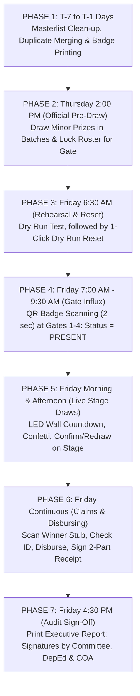

# 🍎 Municipal Teachers' Day 2026 Digital Raffle System
# 📘 Final Teachers' Committee Manual, Operational Sequence & Plain-Language Guide
**Municipality of Malungon, Province of Sarangani**  
*A Non-Technical, Step-by-Step Handbook for School Principals, District Supervisors, Committee Chairs, Secretariat, Gate Marshals, and Disbursing Officers*

---

## 🌟 Executive Summary & Welcome

Dear Teachers' Committee Members, School Heads, and District Supervisors,

On Teachers' Day 2026, more than **2,000 dedicated educators and school personnel** from across the Municipality of Malungon will gather at the Malungon Gymnasium to celebrate. 

In past years, conducting raffle draws by manually drawing paper stubs from a spinning wire drum (*tambiolo*) took **3 to 5 exhausting hours**, created paper ticket jams, lost stubs, and left teachers feeling anxious about whether every school had a fair chance.

This digital raffle system was engineered specifically to solve those problems. It provides:
1. ⚡ **Speed & Efficiency:** Gate registration takes less than **2 seconds** per teacher; hundreds of minor prizes are batch-drawn in minutes.
2. 🛡️ **Absolute Integrity & Fairness:** Powered by certified mathematical shuffling algorithms. Zero secret buttons, zero favoritism ("*no palakasan*"), and no accidental repeat winners.
3. 📺 **Stage Excitement & Pride:** All 5 educational groupings are displayed equally on the gymnasium LED wall with dramatic name-spinning reels, suspenseful audio countdowns, and confetti celebrations.
4. 🔌 **100% Offline Reliability:** Even if the gymnasium Wi-Fi drops completely, every workstation continues to scan, draw, and claim without stopping.
5. 📋 **Complete Audit Compliance:** Every scan, draw timestamp, and claim receipt is recorded into an immutable audit trail, complete with executive signature sheets for DepEd and Commission on Audit (COA) compliance.

This manual explains **how the system works**, **the exact chronological sequence of the event**, and **step-by-step instructions for every committee role**.

---

## 📑 Table of Contents

1. [Plain-Language Explanation: How the System Works & Guarantees Fairness](#1-plain-language-explanation-how-the-system-works--guarantees-fairness)
2. [Personnel Eligibility Rules: Who Can Win What?](#2-personnel-eligibility-rules-who-can-win-what)
3. [The 5 Educational Groupings (Equal District Representation)](#3-the-5-educational-groupings-equal-district-representation)
4. [Master Chronological Event Sequence (From T-7 Days to Post-Event)](#4-master-chronological-event-sequence-from-t-7-days-to-post-event)
5. [The 3-Tier Pre-Draw & Rehearsal Recovery System](#5-the-3-tier-pre-draw--rehearsal-recovery-system)
6. [Workstation-by-Workstation Step-by-Step Manual](#6-workstation-by-workstation-step-by-step-manual)
   - [6.1 Gate Attendance Station (`/attendance`)](#61-gate-attendance-station-attendance)
   - [6.2 Stage & LED Wall Projector Display (`/`)](#62-stage--led-wall-projector-display-)
   - [6.3 Pre-Draw Station for Minor Prizes (`/admin` -> Pre-Draw tab & `/pre-draw`)](#63-pre-draw-station-for-minor-prizes-admin---pre-draw-tab---pre-draw)
   - [6.4 Print Queue Station (`/admin` -> Print Queue)](#64-print-queue-station-admin---print-queue)
   - [6.5 Real-Time Claims Workstation (`/claims`)](#65-real-time-claims-workstation-claims)
   - [6.6 Master Admin Console, Settings & Reports (`/admin`)](#66-master-admin-console-settings--reports-admin)
7. [Committee "Peace of Mind" FAQ & Answers](#7-committee-peace-of-mind-faq--answers)
8. [Role-by-Role Action Checklist for Event Day](#8-role-by-role-action-checklist-for-event-day)

---

## 1. Plain-Language Explanation: How the System Works & Guarantees Fairness

### 1.1 The Digital *Tambiolo* (Certified Randomness)
Instead of physical paper stubs that can stick together or hide in drum corners, the system uses the **Fisher-Yates Shuffling Algorithm**. This is the exact same mathematical standard used in national state lotteries and certified gaming systems. 
* Every teacher who checks in at the gate receives **exactly one entry** in the computer's memory.
* When the draw button is clicked, the computer shuffles the entire candidate pool randomly within milliseconds.
* No one—not the IT technician, not the emcee, and not any committee member—can pre-program or predict who will appear.

### 1.2 Equal District Visibility (The 5-Column LED Wall)
To prevent accusations that "only central schools won", the gymnasium LED wall is divided into **5 educational groupings side-by-side**:
1. **North District**
2. **East District**
3. **West District**
4. **South District**
5. **Private Schools + ECCD / Daycare + Local School Board (LSB)**

Every educator in Malungon, whether teaching in an upland barangay school or a downtown private institution, sees their district represented with equal prominence on screen.

### 1.3 The "Check First" Rule (Two-Stage Confirmation)
When the wheel spins and names appear on the LED wall, they are **provisional (temporary)**:
* **Stage 1 (Review):** The emcee announces the name. The Committee Chairperson or school head verifies that the teacher is qualified and in attendance (if required by committee rules).
* **Stage 2 (Confirm or Redraw):**
  * If valid: Click **"Confirm Winners"** $\rightarrow$ The winner is officially recorded, subtracted from stock, and sent instantly to the Claims Desk.
  * If absent / disqualified: Click **"Redraw Round"** $\rightarrow$ The system discards the provisional name with **zero penalty, zero corrupted records, and zero lost prize counts**, immediately picking a fresh candidate.

### 1.4 Automatic Double-Win Blocking
Once a participant is confirmed as a winner (either in the Thursday Pre-Draw or on the Friday Live Stage), their status is locked to `WINNER = YES`. The computer automatically removes them from all future draws, ensuring that prizes are spread among as many educators as possible.

### 1.5 Instant Forfeiture Restoral (+1 Prize Return)
If a winner declines a prize or fails to claim within the announced deadline, the Claims Officer clicks **"Mark as Forfeited"**. The system records the official reason and **automatically adds +1 unit back into the available prize inventory**, making it ready for an immediate live redraw!

---

## 2. Personnel Eligibility Rules: Who Can Win What?

To maintain full transparency, the Teachers' Committee has established official eligibility guidelines:

| Personnel Group | Minor Prizes (Appliances, Grocery Packs, Cash) | Grand Prize (Top Jackpots / Major Appliances) | Committee Notes & Guidelines |
|---|:---:|:---:|---|
| **Classroom Teachers** (Teacher I, II, III, Master Teachers, Head Teachers) | ✅ **ELIGIBLE** | ✅ **ELIGIBLE** | Fully qualified for all draws upon active gate check-in. |
| **School Principals & PSDS** | ✅ **ELIGIBLE** | ✅ **ELIGIBLE** | Qualified for all draws. PSDS members are mapped to their respective district groupings. |
| **Daycare / ECCD Teachers** | ✅ **ELIGIBLE** | ✅ **ELIGIBLE** | Grouped under "Private / ECCD / LSB" and qualified for all draws. |
| **Local School Board (LSB) Teachers** | ✅ **ELIGIBLE** | ✅ **ELIGIBLE** | Grouped under "Private / ECCD / LSB" and qualified for all draws. |
| **Private School Educators** | ✅ **ELIGIBLE** | ✅ **ELIGIBLE** | Grouped under "Private / ECCD / LSB" and qualified for all draws. |
| **Non-Teaching Staff** (Admin, Clerks, Utility, Security, Nurses, Bookkeepers) | 🟢 **MINOR PRIZES ONLY** | ❌ **EXCLUDED** | Included in all Minor Prize draws (both Live Stage & Pre-Draw), but **strictly protected by system code from winning the Grand Prize**. |

---

## 3. The 5 Educational Groupings (Equal District Representation)

Participants are organized into 5 balanced zones to guarantee complete geographic equity:

```
┌────────────────────────────────────────────────────────────────────────┐
│                   MUNICIPALITY OF MALUNGON (5 GROUPS)                   │
├──────────────┬──────────────┬──────────────┬──────────────┬────────────┤
│ 01. NORTH    │ 02. EAST     │ 03. WEST     │ 04. SOUTH    │ 05. PRIVATE│
│ North Elem   │ East Elem    │ West Elem    │ South Elem   │ ECCD / Day │
│ & High       │ & High       │ & High       │ & High       │ Private Sch│
│ Schools      │ Schools      │ Schools      │ Schools      │ LSB Staff  │
└──────────────┴──────────────┴──────────────┴──────────────┴────────────┘
```

* **North District:** All public elementary and secondary schools in the North zone + North PSDS.
* **East District:** All public elementary and secondary schools in the East zone + East PSDS.
* **West District:** All public elementary and secondary schools in the West zone + West PSDS.
* **South District:** All public elementary and secondary schools in the South zone + South PSDS.
* **Private / ECCD / LSB:** All municipal child development workers (ECCD), private school faculties, and municipal Local School Board teachers.

---

## 4. Master Chronological Event Sequence (From T-7 Days to Post-Event)

The entire event unfolds in 7 distinct operational phases:



---

### Detailed Timeline Breakdown

#### 📅 PHASE 1: Days Before the Event (Preparation & Badges)
* **Who:** Secretariat & IT Committee Lead.
* **Actions:**
  1. **Import Masterlist:** Upload verified school rosters via CSV/Excel in `Admin ➔ Participants`.
  2. **Run Duplicate Resolution:** Use the 4-tier scanner (DepEd ID, Exact Name, Typo/Fuzzy, Phone) to merge any duplicate teacher records.
  3. **Setup Prizes:** Input all sponsored items into `Admin ➔ Prizes`, setting Category (`GRAND` vs `MINOR`) and Pre-Draw flags.
  4. **Print QR Badges:** Under `/attendance ➔ Printable Badges`, print badges laid out 8 per sheet by school/district. Distribute badges to schools prior to the event.

---

#### 📅 PHASE 2: Thursday Afternoon (Official Pre-Draw Day)
* **Time:** Thursday, 2:00 PM – 4:30 PM.
* **Location:** Committee Secretariat Office.
* **Witnesses:** Committee Chairperson, DepEd District Supervisors, and Audit Observers.
* **Actions:**
  1. **Activate Pool for Pre-Draw:** Since teachers have not arrived at the venue yet, go to `Admin ➔ Participants` and ensure roster is marked **"Eligible"**.
  2. **Conduct Batch Draws:**
     - Open `Admin ➔ Pre-Draw Station`.
     - Select minor items (e.g. 100 Electric Fans, 50 Rice Cookers, 200 Grocery Packs).
     - Select batch size (e.g. 10 to 50 names at a time) and click **"Draw Batch"**.
     - Review provisional list in front of witnesses, then click **"Confirm & Commit Batch"**.
  3. **Lock Pre-Draw Winners & Prepare for Friday Gate Check-In:**
     - In the purple banner at the top of Pre-Draw Station, click:  
       👉 **"Prepare Roster for Gate"** (`Reset Non-winners for Gate`).
     - *Result:* The Pre-Draw winners remain permanently locked as `WINNER = YES`. All remaining non-winners become `INELIGIBLE` and must physically scan their badges at the gym gate on Friday morning to enter the Live Stage draw!
  4. **Secure Thursday's Official Results (Crucial):**
     - Click **"Save Snapshot"** *(Locks this state in browser memory)*.
     - Click **"Download Backup (.json)"** *(Downloads backup file to a USB flash drive and Google Drive)*.
  5. **Post Lists:** Click **"Print Batch Document"** and post the signed winner lists on gym announcement bulletin boards.

---

#### 📅 PHASE 3: Friday Morning 6:30 AM – 7:35 AM (Rehearsal & The 1-Click Reset)
* **Time:** 6:30 AM – 7:35 AM (Before venue doors open).
* **Location:** Malungon Gymnasium Main Stage, LED Wall & Entrances.
* **Actions:**
  1. **Audio & Video Test (6:30 AM):**
     - Connect stage laptop to LED Wall via HDMI and sound console via 3.5mm Aux.
     - Open `/`, press `F11`, and test audio countdown ticks and victory fanfare.
  2. **End-to-End Dry Run (7:00 AM):**
     - Gate team scans 3 test badges on tablet.
     - Stage team runs a test draw for 1 Grand Prize.
     - Claims team tests printing 1 sample claim slip.
  3. **The 1-Click Magic Reset (7:35 AM Sharp):**
     - Go to `Admin ➔ Settings ➔ EVENT BACKUP & DRY RUN RECOVERY`.
     - Click the red button:  
       👉 **"Reset Friday Dry Run (Keep Pre-Draw Winners Intact)"**.
     - Enter PIN `2026`.
     - *What happens in 1 second:*
       - 🧹 Clears the 3 test gate scans (attendance count returns to 0).
       - 🧹 Clears the test Grand Prize winner and returns the prize back to stock.
       - 🔒 **KEEPS ALL THURSDAY PRE-DRAW WINNERS 100% INTACT & UNTOUCHED!**
       - ☁️ Instantly syncs across all venue laptops and tablets.

---

#### 📅 PHASE 4: Friday Morning 7:30 AM – 9:30 AM (Gate Influx & Registration)
* **Time:** 7:30 AM – 9:30 AM.
* **Location:** Gates 1, 2, 3, and 4 (Gymnasium Entrances).
* **Actions:**
  1. Arriving teachers present their QR badges.
  2. Marshals scan badges using barcode guns or webcams (takes less than 2 seconds).
  3. **Chime sounds + Green Box appears:** Teacher is marked **PRESENT** and active in the raffle pool.
  4. **Warning buzz sounds:** Duplicate scan alert! Informs marshal the badge was already used.
  5. **Forgot Badge?** Marshal clicks **Manual Search**, types teacher's surname, and clicks **"Check In"**.
  6. **Unlisted / Walk-In Teacher?** Marshals direct teacher to the Master Admin Secretariat Desk, where Secretariat clicks **➕ Add Walk-in Teacher** to verify and register them on the spot.

---

#### 📅 PHASE 5: Friday Program (Live Stage & Major Draws)
* **Time:** Morning Program & Afternoon Program segments.
* **Location:** Gymnasium Stage & Main LED Wall.
* **Actions:**
  1. Operator selects prize (e.g. *₱10,000 Cash* or *55" Smart TV*).
  2. Chooses distribution mode (Combined Pool or Equal Per District).
  3. Emcee builds crowd anticipation: **"3... 2... 1... SPIN!"**
  4. Projector Operator clicks **"Start Live Draw"**.
  5. Mechanical sound ticks play, names cycle on the LED wall, countdown triggers, and confetti explodes!
  6. **Review & Confirm:**
     - Emcee and Committee Chair check the name.
     - If verified: Click **"Confirm Winners"** $\rightarrow$ Sent to Claims Desk!
     - If absent / ineligible: Click **"Redraw Round"** $\rightarrow$ Instant, clean redraw.

---

#### 📅 PHASE 6: Friday Continuous (Claims, Disbursing & Print Queue)
* **Time:** 9:00 AM – 4:30 PM (Continuous operations).
* **Location:** Gymnasium Side Claims Booth.
* **Actions:**
  1. Winning teacher visits the Claims Booth.
  2. Disbursing Officer scans their Winner Verification Stub QR code or searches their surname.
  3. Officer inspects their DepEd ID or PRC License.
  4. Officer enters ID number and clicks **"Verify & Confirm Disbursement"**.
  5. Officer prints the **2-part Claim Receipt**:
     - *Part 1 (Souvenir):* Handed to the winning teacher.
     - *Part 2 (Audit):* Signed by the teacher and filed in the official audit binder.
  6. Physical appliance or cash envelope is released!
  7. *Proxy Claim?* Officer toggles "Proxy Claim", types representative's name and authorization notes before releasing.
  8. *Forfeiture?* Officer clicks "Mark as Forfeited" with a reason; prize instantly returns to stock for a stage redraw.

---

#### 📅 PHASE 7: Post-Event Wrap-Up & Audit Sign-Off
* **Time:** 4:30 PM – 5:15 PM (Event Conclusion).
* **Location:** Secretariat Office / Main Stage.
* **Actions:**
  1. Open `Admin ➔ Reports`.
  2. Click **"🖨️ Print Official Report"**.
  3. The system formats an executive audit summary containing:
     - Total registered vs. verified attendees.
     - Complete list of confirmed winners and claimed prizes.
     - District fairness percentage charts.
     - Total cash and prize valuations disbursed.
  4. The document is formally signed by:
     - **Teachers' Committee Chairperson**
     - **DepEd Public Schools District Supervisors (PSDS)**
     - **Municipal LGU / Commission on Audit (COA) Representative**
  5. Take a final digital backup (`Download Backup (.json)`) for municipal archiving.

---

## 5. The 3-Tier Pre-Draw & Rehearsal Recovery System

One of the greatest fears of any organizing committee is: *"What if our Friday morning rehearsal erases Thursday's Pre-Draw results, or what if someone spills water on the computer?"*

The system features an exclusive **3-Tier Protection Architecture**:

```
┌─────────────────────────────────────────────────────────────────────────────┐
│                       THE 3-TIER RECOVERY ARCHITECTURE                      │
├────────────────────────────────┬────────────────────────────────────────────┤
│ TIER 1: The Emergency Parachute│ Downloadable .json Backup File             │
│                                │ Saved on USB Flash Drive & Google Drive    │
├────────────────────────────────┼────────────────────────────────────────────┤
│ TIER 2: The Quick Bookmark     │ Browser Memory Snapshot                    │
│                                │ Saved with 1 click right after Pre-Draw    │
├────────────────────────────────┼────────────────────────────────────────────┤
│ TIER 3: The Magic Eraser       │ "Reset Friday Dry Run" (1-Click)           │
│                                │ Clears test rehearsal; keeps Pre-Draw safe │
└────────────────────────────────┴────────────────────────────────────────────┘
```

### How to Use Each Tier:
1. **Tier 1 (Emergency Parachute):** After completing Thursday's Pre-Draw, click **Download Backup** in Pre-Draw Station or Admin Settings. This downloads a file named `TeachersDay2026_Backup_[timestamp].json`. Save it on a USB flash drive. If a laptop is completely broken, you can plug the USB into any backup laptop, click **Restore from Backup File**, and the entire event is restored in 5 seconds!
2. **Tier 2 (The Bookmark):** Right after Thursday Pre-Draw finishes, click **Save Snapshot**. This creates an unshakeable restore point right inside the browser.
3. **Tier 3 (The Magic Rehearsal Eraser):** On Friday morning at 7:35 AM (after testing gates, stage projector, and claim slips), go to `Admin ➔ Settings` and click **"Reset Friday Dry Run (Keep Pre-Draw Winners Intact)"**. It removes all test rehearsal data while keeping all Thursday winners completely untouched.

---

## 6. Workstation-by-Workstation Step-by-Step Manual

### 6.1 Gate Attendance Station (`/attendance`)
* **Primary URL:** `https://teachers-day-raffle-system.web.app/attendance` (or local venue network)
* **Default Gate PIN:** `2026`
* **Assigned To:** Gate Registration Marshals.

#### Login Steps:
1. Open the browser to `/attendance`.
2. Select your Station (e.g. `Gate 1 - Main Gymnasium Entrance`).
3. Enter Marshal Name (e.g. `Teacher Joy / Registration Committee`).
4. Enter PIN: `2026` and click **Authenticate & Open Gate**.

#### Operating Modes:
* **Barcode Scanner Gun (Fastest):** Click **Barcode Gun** tab. Point scanner at teacher's badge QR code. Scan processes in 0.2 seconds.
* **Camera Scanning:** Click **Camera** tab, click **Start Camera**, hold badge to lens.
* **Manual Search:** Click **Manual** tab. Type teacher's surname or DepEd ID, then click **"Check In (Mark Present)"**.

#### Sound & Visual Signals:
* 🟢 **Double Chime + Green Banner:** Valid entry! Teacher is marked **PRESENT** and active in the raffle pool.
* 🟠 **Warning Buzz + Amber Banner:** Already checked in! Shows exact gate and time of previous scan.
* 🔴 **Error Tone + Red Banner:** Badge not found. Direct teacher to Master Admin Secretariat Desk.

---

### 6.2 Stage & LED Wall Projector Display (`/`)
* **Primary URL:** `https://teachers-day-raffle-system.web.app`
* **Assigned To:** Projector Operator, Stage Emcee, and Committee Chairperson.

#### Setup Steps:
1. Connect laptop to gym LED Wall via HDMI and sound console via 3.5mm Aux cable.
2. Open the raffle website.
3. Select **Projector Display** view.
4. Press **`F11`** for browser fullscreen.
5. Click **"Toggle Full Stage"** to hide all administrative navigation bars, presenting a clean 5-district view.

#### Running a Live Draw:
1. Select the prize from the dropdown.
2. Select **Distribution Mode**:
   - *Combined Pool:* Shuffles all checked-in teachers from all 5 districts equally.
   - *Equal Per District:* Draws an equal number of winners simultaneously from each district.
3. Set the quantity of winners to draw.
4. Click **Commence Draw →** $\rightarrow$ Click **Start Live Draw**.
5. Audiences watch names cycle rapidly with mechanical audio ticks, followed by an animated **3... 2... 1...** countdown and victory fanfare with confetti!
6. **Confirmation Step:**
   - Click **"Confirm Winners"** to make the result official and push to Claims.
   - Click **"Redraw Round"** if the winner is absent or disqualified.

---

### 6.3 Pre-Draw Station for Minor Prizes (`/admin` -> Pre-Draw tab & `/pre-draw`)
* **Primary URL:** `/admin` (Pre-Draw Station tab) and `/pre-draw` (Carousel Viewer)
* **Assigned To:** Secretariat Committee & Audit Witnesses.

#### Conducting Pre-Draw Batches:
1. Select minor prize item (e.g. *Desk Fan - 50 units*).
2. Set batch size (e.g. 25 winners per round).
3. Set reel duration (default: 3 seconds).
4. Click **"Draw Batch"**.
5. Review the provisional list with official witnesses.
6. Click **"Confirm & Commit Batch"** $\rightarrow$ Winners are committed and sent to Claims!
7. Click **"Print Batch Document"** to print the official signed sheet for gym bulletin boards.
8. On hallway or side monitors, open `/pre-draw` for an automatic cycling carousel of all pre-draw winners!

---

### 6.4 Print Queue Station (`/admin` -> Print Queue)
* **Primary URL:** `/admin` (Print Queue tab)
* **Assigned To:** Print Marshals & Secretariat.

#### Features:
1. Every confirmed draw (Stage and Pre-Draw) automatically enters the Print Queue.
2. **Winner Verification Stub:** Prints a compact slip with teacher details, prize name, draw number, timestamp, and a secure verification QR code.
3. **Batch Master Sheet:** Prints a full tabular roster of that draw round for supervisor signatures.
4. Click **"Mark as Printed"** once paper documents are produced.

---

### 6.5 Real-Time Claims Workstation (`/claims`)
* **Primary URL:** `https://teachers-day-raffle-system.web.app/claims`
* **Default Claims PIN:** `2026`
* **Assigned To:** Disbursing Officers & Claims Marshals.

#### Processing a Claim:
1. Log in with Officer Name and PIN `2026`.
2. Locate winner by scanning their Winner Verification Stub QR code or typing their surname in the search bar.
3. Ask for their **DepEd ID, PRC License, or Government ID**.
4. Type the ID number into the **ID Presented** field.
5. Click **"Verify & Confirm Disbursement"**.
6. Click **"Print Claim Slip Receipt"** (2-part receipt: Part 1 for Teacher, Part 2 signed for Secretariat audit binder).
7. Release the prize!

#### Special Situations:
* **Proxy Claim:** Toggle "Proxy Claim: YES", enter Representative Name, Relationship, and notes before confirming.
* **Prize Forfeiture:** Click "Mark as Forfeited", enter the reason, and the prize immediately returns (+1) back to stock for a stage redraw!

---

### 6.6 Master Admin Console, Settings & Reports (`/admin`)
* **Primary URL:** `/` (Click Admin tab)
* **Default Admin PIN:** `2026`
* **Assigned To:** Committee Chairperson & Technical Lead.

#### Key Functions:
* **Dashboard Overview:** Real-time counter of total attendees, total winners, and remaining prize units.
* **Participants Manager:** Import rosters, search teachers, resolve duplicates, and add walk-in educators.
* **Prizes Manager:** Create/edit prizes, designate Grand vs Minor tiers, and track remaining inventories.
* **Raffle Audit Logs:** Immutable millisecond-stamped record of every scan, draw, redraw, and disbursement.
* **Reports View:** Real-time district fairness charts and the executive **"Print Official Report"** button with formal signature blocks for Committee, DepEd, and COA.
* **Settings & Recovery:** Change PINs, modify Event Title, create snapshots, download backups, and trigger the Tier 3 Dry Run Reset.

---

## 7. Committee "Peace of Mind" FAQ & Answers

### ❓ Q1: Can the computer technician or operator secretly rig who wins?
**Answer: Absolutely NOT.**  
The system uses the certified Fisher-Yates mathematical shuffling algorithm. The computer shuffles candidates randomly within milliseconds at the exact moment the button is pressed. Every draw is permanently recorded into the immutable audit trail with an unalterable timestamp and transaction ID for DepEd and COA review.

### ❓ Q2: What happens if the gymnasium Wi-Fi drops or internet disconnects?
**Answer: Zero problem.**  
The application is engineered as an offline Progressive Web App (PWA). All data is cached directly in the laptop's secure local browser storage (`localStorage`). Scanners, stage draws, and claim desks will continue running without hesitation. As soon as Wi-Fi returns, records automatically sync to the cloud database.

### ❓ Q3: What if an absent teacher's name is drawn on stage?
**Answer:** The emcee and committee chair follow announced house rules. If your rule requires physical presence, the operator clicks **"Redraw Round"**. The absent name is discarded, no prizes are lost, and a new name is drawn immediately.

### ❓ Q4: Can a teacher win more than once?
**Answer: NO.**  
As soon as a teacher wins any prize (whether during Thursday's Pre-Draw or Friday's Live Stage), their record is locked as `WINNER = YES`. The system automatically excludes them from all subsequent draws.

### ❓ Q5: Can non-teaching personnel win the Grand Prize?
**Answer: NO.**  
Per official Teachers' Committee policy, non-teaching staff (utility, clerks, security, nurses, admin) are warmly included in all Minor Prize draws, but are **strictly excluded by system code from the Grand Prize**.

### ❓ Q6: What if an unlisted teacher arrives at the gate?
**Answer:** Gate marshals direct the teacher to the **Master Admin Secretariat Desk**. The Secretariat clicks **➕ Add Walk-in Teacher**, types their details, selects "Eligible (Checked In)", and clicks Save. The teacher is registered and active in the raffle pool in under 30 seconds.

### ❓ Q7: What if an officer accidentally clicks "Claim" on the wrong person?
**Answer:** In the Claims Workstation, the officer can click **"Unclaim Prize"** to safely revert the status back to Unclaimed.

---

## 8. Role-by-Role Action Checklist for Event Day

### 🟢 1. Gate Attendance Marshals (Entrances)
- [ ] Arrive at 6:30 AM; boot laptops/tablets at Gates 1, 2, 3, and 4.
- [ ] Open `/attendance`, select gate station, enter name, enter PIN `2026`.
- [ ] Connect and test barcode scanner gun (listen for test chime).
- [ ] Influx (7:00 AM – 9:30 AM): Greet teachers, scan QR badges, ensure green checkmark appears.
- [ ] If duplicate buzz sounds: Politely notify teacher of prior check-in.
- [ ] If badge forgotten: Switch to "Manual" tab, search surname, click "Check In".
- [ ] If unlisted: Direct teacher to Master Admin Secretariat Desk.

### 🟣 2. Stage & Projector Crew (Gymnasium AV Desk)
- [ ] Arrive at 6:30 AM; connect laptop to LED Wall via HDMI and sound console via 3.5mm Aux.
- [ ] Open `/`, switch to Projector Display, press `F11` (Fullscreen), click "Toggle Full Stage".
- [ ] Rehearsal (7:00 AM): Test countdown reel, audio ticks, fanfare, and confetti.
- [ ] During Program: Coordinate with Emcee before clicking "Commence Draw".
- [ ] Post-Draw: Only click "Confirm Winners" once verified by the Committee Chair.

### 🟡 3. Pre-Draw Secretariat Team (Committee Office)
- [ ] Thursday 2:00 PM: Gather official audit witnesses and school head observers.
- [ ] Open `/admin ➔ Pre-Draw Station`, batch-draw minor prizes in bulk lots.
- [ ] Commit each batch and immediately print the signed **Batch Document**.
- [ ] Click **"Prepare Roster for Gate"** to lock Thursday winners and set non-winners for gate check-in.
- [ ] Click **"Save Snapshot"** and **"Download Backup (.json)"** to a USB flash drive.
- [ ] Post signed winner sheets on gymnasium bulletin boards.

### 🔵 4. Prize Claiming Officers (Side Booths)
- [ ] Arrive at 7:00 AM; open `/claims`, enter station ID, enter officer name, enter PIN `2026`.
- [ ] Verify printer has paper and ink.
- [ ] When teacher arrives: Scan Winner Stub QR code or search surname.
- [ ] Verify DepEd ID or PRC License; type ID number into verification box.
- [ ] Click "Verify & Confirm Disbursement" and print 2-part claim receipt.
- [ ] Have teacher sign Part 2 and file into official audit binder; disburse prize.
- [ ] If proxy: Fill in Proxy Name, Relationship, and authorization notes.
- [ ] If forfeited: Click "Mark as Forfeited" to immediately return prize unit (+1) to inventory!

### 🔴 5. Committee Chairperson & District Supervisors
- [ ] Announce official raffle rules (presence requirements, claim deadlines) during opening remarks.
- [ ] Oversee live stage winner verifications.
- [ ] At 7:35 AM Friday: Verify Tier 3 Dry Run Reset was executed before gates opened.
- [ ] At 4:30 PM Friday: Open `Admin ➔ Reports`, click **"Print Official Report"**, and sign executive audit summary alongside DepEd PSDS and COA/LGU representatives.

---

*Official Document of the Municipal Teachers' Day Organizing Committee*  
*Municipality of Malungon, Province of Sarangani — Celebrating Our Dedicated Educators!*
